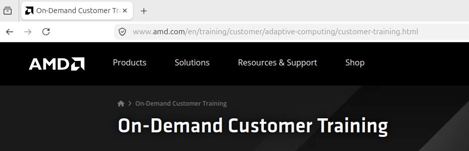

# AMD On-Demand Customer Training

- https://www.amd.com/en/training/customer/adaptive-computing/customer-training.html
- https://learningcatalog-amd.netexam.com

This page represents the AMD Adaptable Learning Customer Training Center for technical training courses for AMD (Xilinx) hardware and software solutions.
Depending on the time of year, there are several **free**, instructor-led virtual workshops:
- Applying Timing Constraints in FPGA Designs Workshop: Covers Vivado design features and clock domain crossing strategies.
- Designing with AMD Spartan UltraScale+ Architecture: Introduces components and system design capabilities for Spartan UltraScale+ FPGAs.
- Getting Started with AMD Embedded x86 Processors: A structured introduction to designing with Zen 5, Epyc, and Ryzen processors.
- Introduction to AMD Versal Adaptive SoC: Explains the Versal Network on Chip (NoC) and AI Engine architectures.

# Xilinx Video Series and Blog Posts

- https://adaptivesupport.amd.com/s/question/0D52E00006hpsS0SAI/xilinx-video-series-and-blog-posts?language=en_US

This page serves as a central, structured directory for the **Xilinx Video Series** and **Blog** Posts, offering tutorials and documentation for engineering video applications. It provides resources for:
- Designing, simulating, and debugging video pipelines on AMD/Xilinx FPGAs and Adaptive SoCs
- Beginner series tutorials
- IP-specific tutorials
- Debugging guides
- The AXI4-Stream protocol
- RTL simulation techniques
- Hardware-specific implementations using Xilinx IPs
- Advanced processing capabilities:
  - VDMA
  - Picture-in-Picture
  - VPSS integration 

# AMD Adaptive Computing Wiki

- https://xilinx-wiki.atlassian.net/wiki/spaces/A/overview?homepageId=18844350

The AMD Adaptive Computing Wiki is the official, documentation and support platform for Xilinx hardware, offering technical guides, Linux development resources, and GitHub repository links for adaptive computing solutions. It provides support for FPGA design, embedded software development, and specific platforms such as Zynq UltraScale+ and Versal.

# AMD University Program

- https://www.amd.com/en/corporate/university-program.html

The AMD University Program (AUP) is providing educators and researchers with advanced hardware, software, and AI/HPC cluster access. 
The site offers specialized resources, including technology donations and curriculum support, for university faculty and staff who enroll with an academic email address.
The learning resources for students include:
- AI Tutorials
- AI Teaching Solutions
- Adaptive Computing Training

# Doulos KnowHow Workshops

- https://www.doulos.com/events/workshops/

Doulos is a leading provider of training and consulting services for engineers in the semiconductor and electronics industries. Their KnowHow Workshops offer hands-on training in FPGA design, verification, and embedded systems development. Also here you can find some **free** online workshops and webinars (With thanks to AMD for sponsoring this workshop).

# BLT

- https://bltinc.com/course-calendar/

BLT is an engineering company that also provides AMD Xilinx training. Webinars and some workshops are free. You can find free workshops by searching for "(Sponsored by AMD)".

# 

Xilinx is now part of AMD, so these documents are hosted at **docs.amd.com**. You can find each document by searching document number, such as "UG949".

### Start here (applies to any device)
- **UG949 - UltraFast Design Methodology Guide.** Read this first. The absolute "must-read" document for any Xilinx engineer. It covers HDL coding style, clocking, resets, constraints, and timing closure.
- **UG1292 - UltraFast Timing Closure Quick Reference.** A checklist version of UG949.
- **WP272 - "Get Smart About Reset: Think Local, Not Global."** A short white paper that changes how most people write resets.
- **UG901 - Vivado Synthesis.** Explains coding templates, inference of RAM, DSP, and shift registers from your HDL code, and synthesis attributes.
- **UG903 - Using Constraints.** For learning Xilinx Design Constraints (XDC). Covers XDC, clocks, I/O delays, and timing exceptions. Most timing problems trace back to this.
- **UG906 - Design Analysis and Closure Techniques.** Shows how to read timing reports and fix failing paths.

### Vivado tool flow

#### 1. The Core Vivado Execution Pipeline
- **UG892** Design Flows Overview: Provides a overview of how a project progresses from RTL synthesis down to bitstream generation., 
- **UG904** Implementation, It details the placement, routing, and optimization phases. Read this specifically to understand physical optimization commands (phys_opt_design) when you are struggling to fix timing errors.
- **UG900** Logic Simulation. It explains how to compile simulation libraries, configure the native Vivado Simulator (XSIM), and generate functional test benches.
- **UG908** Programming and Debugging (ILA/VIO). It teaches you how to insert an Integrated Logic Analyzer (ILA) or Virtual Input/Output (VIO) directly into your design fabric to probe real-time electrical signals inside the running FPGA via JTAG.

#### 2. Automation & Scripting (CI/CD and Pro Flows)
- **UG894** Using Tcl Scripting. Explains how to orchestrate the entire Vivado compilation suite via scripts. This is essential for building Continuous Integration (CI/CD) pipelines on remote build servers. 
- **UG835** Tcl Command Reference, for scripted and non-project flows. A massive, dictionary-style reference manual. You do not read this cover-to-cover; you use it to look up the exact syntax, flags, and return objects for commands like get_cells, get_pins, or create_clock.

### 3. Intellectual Property (IP) & Bus Protocols
- **UG896** Designing with IP, Teaches you how to configure, customize, and manage Xilinx IP cores (like clock wizards, memory controllers, and counters) and how to package your own custom RTL into reusable IP blocks.
- **UG994** IP Integrator (block design), The user guide for the visual Block Design (.bd) workspace. This is where you graphically wire complex subsystems together, highly critical when connecting ARM processor cores (Zynq/MPSoC) to the programmable logic fabric.
- **UG1037** AXI Reference Guide. FPGAs communicate internally using the ARM AMBA AXI protocol. This document explicitly breaks down the handshake behaviors, interface requirements, and signal timing specifications for AXI4-Lite (register configuration), AXI4 (burst memory access), and AXI4-Stream (high-speed continuous data processing).

If you are transitioning to scripting your builds, focus on UG894 and UG904 first. 
If you are designing systems that involve data movement (DMA, PCIe, or external DDR memory), read the signal handshake rules in UG1037 very carefully—90% of custom interface bugs stem from an incorrect implementation of the AXI VALID/READY handshake interface logic.

### Device architecture (read the set for your family)
**7 Series (Artix-7, Kintex-7, Virtex-7, Zynq-7000 PL):**
- UG471 SelectIO, Electrical characteristics of pins, single-ended vs differential standards (LVDS), and internal delays.
- UG472 Clocking, How to safely route clocks, use global clock buffers (BUFG), and configure MMCMs/PLLs.
- UG473 Block RAM: How to construct FIFO arrays and dual-port BRAM blocks properly, 
- UG474 Inside Configurable Logic Blocks (CLBs), LUTs, carry chains, and distributed RAM, 

And read the following when:
- UG479 DSP48E1, when You are doing digital signal processing (filtering, FFTs), custom cryptography, or building neural networks.
- UG476 (GTH/GTX) & UG482 (GTP) Transceivers, when You are designing ultra-fast data links like PCIe, 10GbE, SATA, or custom high-speed optical lines.
- UG483 PCB Design, when You are the Hardware Engineer drawing the circuit board in Allegro, Altium, or KiCad.
- UG470 Configuration, when You are designing a custom PCB or writing flash-programming software.
- The device data sheet 
- DS180 7 Series FPGAs Overview: Device Selection & Migration Paths. The FPGA Feature Summary table lists exactly how many LUTs, Block RAM blocks, DSP slices, and high-speed transceivers exist per specific chip package (e.g., XC7A35T vs XC7A100T).  If you are designing a PCB and think you might need a larger FPGA later, DS180 tells you which chips share the exact same physical package footprint so you can swap the chips out later without rewriting your board design. **footprint compatible**. 
- plus the family's DC/AC switching data sheet)
  - Artix-7: DS181
  - Kintex-7: DS182
  - Virtex-7: DS183
  - Zynq-7000: DS191
  - Spartan-7: DS189

When building an FPGA, your process looks like this:
1. Look at DS180 to pick your chip and make sure it has enough resources.
2. Open UG483 and the specific DC/AC Data Sheet (like DS181) to design your hardware schematics and power supplies safely.
3. Open UG949 and the specific block user guides (UG473, UG479, etc.) to write your actual HDL code and constrain it.

**UltraScale / UltraScale+:**

- UG571 SelectIO, 
- UG572 Clocking, 
- UG573 Memory Resources, 
- UG574 CLBs, 

- UG579 DSP48E2, 

- UG570 Configuration, 
- UG576 or UG578 Transceivers, 
- UG581 GTM, UltraScale+ added PAM4 modulation capability
- UG583 PCB Design

- DS890 UltraScale Overview: 
- UG575 Packaging and Pinouts
- UG580 System Monitor, SYSMON block

### IP product guides (PG-series)
1. The Memory Controllers
• UG586: 7 Series FPGAs Memory Interface Solutions: Note that for the 7-Series Memory Interface Generator (MIG), Xilinx used a UG prefix instead of a PG, making this an exception to the rule. This is the manual for routing DDR3/DDR2 layout and timing constraints on older boards.
• PG150: UltraScale Architecture-Based FPGAs Memory IP: The true PG equivalent for UltraScale/UltraScale+. It covers the configuration of the high-speed DDR4 memory controllers and calibration logic.
1. The Bus & Interconnect Fabric
• PG059: AXI Interconnect Product Guide: Mandatory reading for anyone building Block Designs. It explains how Vivado routes traffic when you connect multiple AXI masters to multiple AXI slaves, crossbar configurations, and data-width conversions.
• PG210: AXI SmartConnect Product Guide (Missing Gap): In modern Vivado designs (especially UltraScale+ and Zynq MPSoC), Xilinx heavily replaced the older AXI Interconnect with the AXI SmartConnect. It is a smarter, lower-latency IP that optimizes routing automatically. You must add PG210 to this section.
1. High-Speed Connectivity (The PCIe Playbook)
You mentioned "the PCIe guides for your device." To make your list complete, you should name the actual standard PGs used in 90% of industrial projects:
• PG195: DMA Subsystem for PCI Express (XDMA): The industry workhorse. If you need to stream massive amounts of data from an FPGA straight into host PC RAM over PCIe, you use the XDMA IP. This guide explains the register maps and descriptor rings.
• PG213: UltraScale+ Devices Integrated Block for PCI Express: If you are writing a custom PCIe physical layer or transport protocol without the standard Xilinx DMA wrappers, this is your bible.
1. Networking Infrastructure (Ethernet)
• PG211: AXI 1G/2.5G Ethernet Subsystem: The standard guide for setting up typical gigabit internet lines connected to an internal processor or state machine.
• PG157: UltraScale+ Devices Integrated 100G Ethernet IP: If you are working on data center cards (like Alveo) or high-bandwidth telecom hardware, this guide governs the CMAC hard-IP block which pushes 100 Gbps network streams natively.

### SoCs (if you're using a processor)
- **UG585** Zynq-7000 Technical Reference Manual. : The foundational manual for the original dual-core ARM Cortex-A9 + 7-Series fabric. It tracks how the Processing System (PS) resets, how it boots from an SD card or QSPI flash, and how it directly interrupts or maps memory to the Programmable Logic (PL).
- **UG1085** Zynq UltraScale+ MPSoC Technical Reference Manual, plus **UG1137** Software Developer Guide: : This hardware is infinitely more complex. It handles a quad-core ARM Cortex-A53, a dual-core real-time ARM Cortex-R5, a GPU, and a Platform Management Unit (PMU). UG1137 is mandatory for software engineers setting up hypervisors, hardware virtualization, multi-OS boot sequences, or PetaLinux BSPs.
- **AM011** Versal Technical Reference Manual, plus the Versal system and design flow guides. Versal isn't just an FPGA with a CPU—it is a software-programmable network-on-chip. AM011 moves away from traditional user guides (UG) to Architecture Manuals (AM). It describes the hard-wired Programmable Network on Chip (NoC), the Platform Management Controller (PMC), and the core engine scaling.

#### The Software Engine Toolchains (Vitis)

- **UG1393**: Vitis Unified Software Platform Documentation: This is the software developer's "Vivado." The core IDE manual used to compile C/C++ bare-metal code, package hardware wrappers, and generate final boot images (BOOT.BIN).
- **UG1144**: PetaLinux Tools Documentation: Reference Guide: The embedded Linux build system guide. Mandatory if your processor runs an operating system requiring custom device trees, drivers, and root filesystems.

#### The Chip Ecosystem Guides (Pick Your Silicon Target)

An engineer should isolate their reading strictly to the family they are physically using:
Option 1: The Zynq-7000 Architecture (Entry Level / 7-Series Fabric)
• UG585: Zynq-7000 Technical Reference Manual (TRM): Explains the basic dual-core ARM Cortex-A9 interactions, clocking, resets, and basic memory mapping to the 7-series programmable logic.
• UG585 Appendix B (Register Map): The definitive programmer's reference containing the explicit hexadecimal addresses for low-level peripheral configuration and driver building.
Option 2: The Zynq UltraScale+ MPSoC Architecture (Mid-to-High Tier)
• UG1085: Zynq UltraScale+ MPSoC TRM: Explains the advanced quad-core Cortex-A53, dual-core Cortex-R5, GPU, and Platform Management Unit (PMU).
• UG1137: Software Developer Guide: Crucial for managing complex processor boots, running multiple operating systems simultaneously, hardware virtualization, and multi-core security segregation.
• UG1087: Zynq UltraScale+ MPSoC Register Reference: A dictionary-style guide mapping out every control and status bit across the entire processor sub-system.
Option 3: The Versal Adaptive SoC Architecture (Next-Gen Software-Defined Silicon)
• UG1273: Versal System and Solution Planning Methodology Guide: The overarching methodology playbook (the UltraFast equivalent) detailing how to properly scope a high-speed Versal project before writing any code.
• AM011: Versal Adaptive SoC TRM: Covers the Platform Management Controller (PMC), the hard-wired processor subsystems, and overall structural constraints.
• PG313: Versal Programmable Network on Chip (NoC) & Integrated Memory Controller: Explains how packets route across the internal silicon highway. You cannot bypass this; standard fabric routing no longer hooks directly to external memory controllers.
• AM009: Versal AI Engine Architecture Manual: Required reading only if using the specialized AI Core/Edge variants to run vectorized machine learning or complex signal array configurations.
• AM012: Versal Adaptive SoC Register Reference: The low-level address directory for custom operating system driver development and deep hardware debugging.

### HLS
- UG1399: Vitis High-Level Synthesis User Guide: The undisputed Bible for HLS. This is where you learn how C/C++ code constructs map onto hardware elements. You read this to master essential optimization pragmas like loop unrolling (#pragma HLS unroll), pipelining (#pragma HLS pipeline), and memory array partitioning (#pragma HLS array_partition).
- UG1391: Vitis HLS Introduction (Missing Onboarding Piece): A much shorter, introductory manual designed specifically to teach traditional software developers (C/C++) how to conceptualize dataflows, streaming interfaces, and execution latency before reading the dense reference guide.
- The HLS Libraries Reference (Implicit Requirement): Depending on your algorithmic target, you will need to add one of the standard hardware-accelerated library guides:
  - Vitis Vision Library: Mandatory if you are converting OpenCV C++ code into live camera streaming pipelines.
  - Vitis Solver / BLAS Libraries: Crucial if you are executing heavy matrix multiplications, linear algebra routines, or custom scientific acceleration.

### Suggested reading order
1. UG949
2. The CLB, clocking, and memory guides for your device family
3. UG903 and UG906, once you start hitting timing problems
4. Other guides as you need them

Reading UG949 alongside your family's clocking guide will prevent most beginner mistakes.
